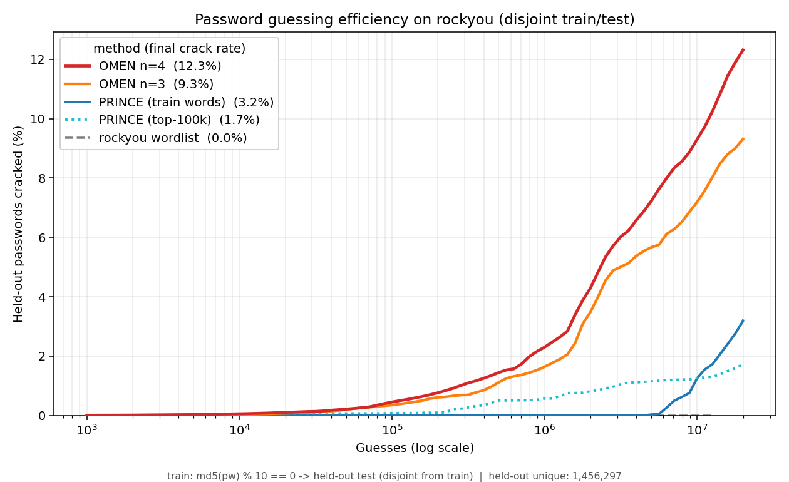

# OMEN-reborn

OMEN-reborn is a clean-room **Ordered Markov ENumerator**. It generates
password candidates, ranked by probability. It is modern, dependency-free
Python.

OMEN builds an order-`n` Markov model from a corpus of cracked passwords. It
streams candidate guesses in approximately descending probability order. That
ordering is the whole point: a back-end like hashcat tries the most likely
passwords first. It cracks more passwords for the same number of guesses.

This is an **independent implementation, written from the published
algorithm** (Dürmuth et al., *OMEN: Faster Password Guessing Using an Ordered
Markov Enumerator*, ESSoS 2015). No code from the original RUB-SysSec OMEN is
used.

This README covers install, usage, and build commands. For language
profiles, model internals, performance tuning, and the dev workflow, see the
**[User Guide](USERGUIDE.md)**.

## Benchmark: OMEN vs. PRINCE

Trained on 90% of `rockyou` and evaluated on the **disjoint** held-out 10%
(split by `md5(password) % 10`, so no password is in both sets). The chart shows
the cumulative share of the 1,456,297 held-out passwords cracked as a function
of the number of guesses.



| Method | Crack rate @ 20M guesses |
|--------|-------------------------:|
| **OMEN n=4** | **12.3%** |
| OMEN n=3 | 9.3% |
| PRINCE (train words) | 3.2% |
| PRINCE (top-100k) | 1.7% |
| rockyou wordlist (replay) | 0.0% |

OMEN cracks **~4× more** than the best PRINCE configuration, at the same
guess budget. The reason: OMEN generates new character sequences from a
Markov model. PRINCE only recombines existing words.

The wordlist baseline sits at exactly **0.0%**. Replaying training words
cracks nothing on a disjoint test set. This confirms two things: there is no
train/test leakage, and every OMEN crack is genuine generalisation.

PRINCE still has real strengths — no training needed, direct hashcat
pipelining, no alphabet or length limits. Those strengths are about
operation, not about guess ordering.

Full methodology and a one-command reproduction are in
[`benchmarks/`](benchmarks/README.md).

## Install

Runtime is **stdlib-only**. Run it as a module from the repo root:

```bash
python -m omen ...
```

Or install it, to get the `omen` console script:

```bash
pip install .
```

For a development install, see the **[User Guide](USERGUIDE.md#development)**.

## Usage

```bash
# 1. Train a model from a password list (max length is auto-computed from
#    the corpus's own length spread — pass --max-length to fix it yourself)
omen train -i cracked.txt -m model/ --ngram 3 --levels 11

# 1b. Sparse org corpus? Supplement it with the first 500K rockyou passwords
#     so the n-gram model isn't starved on a handful of cracks (0 = whole file)
omen train -i cracked.txt -m model/ --supplement rockyou.txt --supplement-lines 500000

# 2. Stream ranked candidates (this is what you pipe into a cracker)
omen generate -m model/ --max-guesses 5000000 | hashcat -a 0 -m 1000 hashes.txt

# 3. Score individual passwords (clean replacement for evalPW)
#    --rank uses native/omen-rank on its own once you build it (see below)
omen eval -m model/ Password1 hunter2 --rank

# 4. Inspect a trained model
omen inspect -m model/

# 5. Choose / preview an alphabet from a corpus
#    --profile reserves a language's floor characters first (see the User Guide)
omen alphabet -i cracked.txt --size 72 --profile de
```

### Commands

| Command    | Purpose                                                        |
|------------|---------------------------------------------------------------|
| `train`    | Corpus → model directory.                                     |
| `generate` | Stream ranked candidates to **stdout** (SIGPIPE-clean).       |
| `eval`     | Per-password total level, component breakdown, optional rank. |
| `alphabet` | Select the most frequent characters and report coverage.      |
| `inspect`  | Model metadata, table sizes, per-table level histograms.      |
| `spool`    | Chunk a producer's output into tmpfs files; attack each with hashcat. |

## How it works

OMEN turns each conditional probability into an integer **level**. Level 0 is
the most probable; level `NL-1` is the least. The formula is
`level(p) = round(-ln p / lam)`.

A candidate's **total level** is the sum of its components:

```
total = IP(initial n-1 gram) + Σ CP(transition) + EP(ending) + LN(length)
```

The enumerator walks `total = 0, 1, 2, …`. At each total, it emits *every*
candidate with that total before moving to the next. This makes the output
stream globally non-decreasing in level.

One `LevelScale` is shared by all tables. This keeps every component
additive and comparable. `omen eval` recomputes the same total-level value,
so a password's score always equals the level the generator would emit it
at.

See the **[User Guide](USERGUIDE.md)** for language profiles, password
length tuning, the on-disk model format, and the codebase's module map.

## Performance: native enumerator + chunked feeding

The pure-Python `PyEnumerator` emits ~10⁵ candidates/s. That's fine for
analysis, but too slow to feed a fast GPU back-end. Three pieces close the
gap. See the **[User Guide](USERGUIDE.md#performance-details)** for how
each one works, portability notes, and tuning guidance.

### Native C enumerator (`native/omen-enum`)

**~50–100× faster** than the pure-Python enumerator, byte-for-byte
identical output. POSIX-only (Linux, macOS); on Windows, use `python -m
omen generate` instead.

```bash
make -C native                      # produces native/omen-enum
native/omen-enum model/ --max-guesses 50000000 | hashcat -a 0 -m 1000 hashes.txt
```

### Native C rank estimator (`native/omen-rank`)

50 to 100 times faster than `omen eval --rank`'s Python path. POSIX-only;
on Windows, `eval --rank` uses the Python path automatically.

```bash
make -C native omen-rank
native/omen-rank model/ --rank-cap 10000000 Password1 hunter2
native/omen-rank model/ -i passwords.txt > ranks.txt   # many passwords, one run
```

`eval --rank` uses this tool on its own once it's built. No extra flag
needed.

### Chunked spool-and-attack (`omen spool`)

Piping into hashcat over stdin caps throughput. `omen spool` spools the
producer into RAM-backed chunk files instead, and attacks each one.

```bash
omen spool --hashcat "hashcat -a 0 -m 1000 {chunk} hashes.txt" --chunk-mb 512 \
           -- native/omen-enum model/
```

## License

MIT — see [LICENSE](LICENSE).
